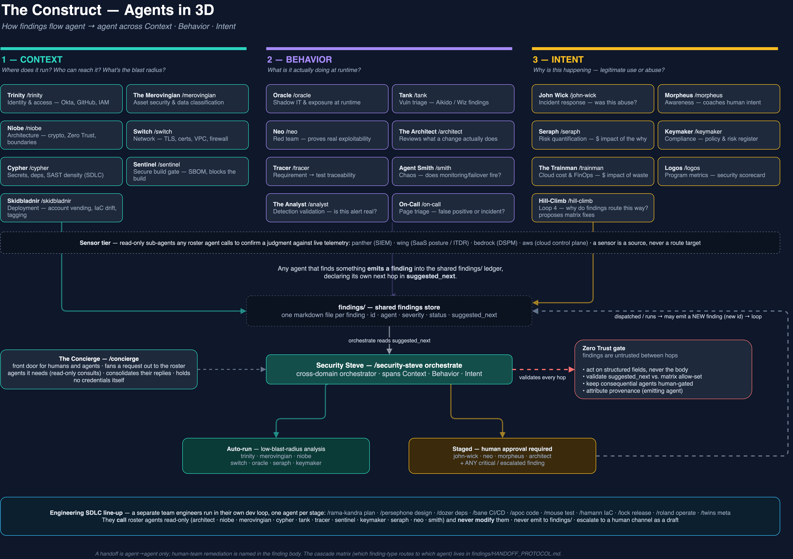

# The Construct

[](https://github.com/monte-carlo-data/the-construct/actions/workflows/ci.yml)

> *"The Construct is our loading program. We can load anything."*

The Construct is your organization's AI-powered security agent roster — a team of Claude-powered specialists, each one owning a specific security domain — plus a second line-up of engineering agents that shift security checks left into every stage of the SDLC. Every agent is a Claude Code skill: drop it in your repo, configure your MCP servers, and it runs.

They're named after characters from *The Matrix*.



---

## The Matrix — the security roster

| Agent | What it does | Security Domain | Invoke |
|---|---|---|---|
| **Neo** | Red team — autonomous penetration tests via PentAGI | CISSP Domain 6: Security Assessment & Testing | `/neo` |
| **Trinity** | Identity & access — audits Okta, GitHub, and AWS IAM for over-privileged accounts and stale access | CISSP Domain 5: Identity & Access Management | `/trinity` |
| **Oracle** | Shadow IT & exposure — monitors for unapproved AI tools, exposed endpoints, and cloud misconfiguration; reads your approved-inventory lists from Git | CISSP Domain 7 / Domain 4 (partial) | `/oracle` |
| **Morpheus** | Security awareness — drafts just-in-time Slack outreach when risky behavior is detected | CISSP Domain 1: Security & Risk Management | `/morpheus` |
| **Seraph** | Cyber risk quantification — translates a risk, ticket, or finding into dollar-denominated loss exposure (FAIR + Monte Carlo simulation) | CISSP Domain 1: Security & Risk Management | `/seraph` |
| **Tank** | Vulnerability triage & management — investigates Aikido and Wiz findings, routes to remediation | CISSP Domain 6: Security Assessment & Testing | `/tank` |
| **The Architect** | Security code review — PR security reviews | CISSP Domain 3: Security Architecture & Engineering | `/architect` |
| **The Merovingian** | Asset security & data classification — data inventory, classification, privacy exposure; confirms where sensitive data really lives via DSPM | CISSP Domain 2: Asset Security | `/merovingian` |
| **Cypher** | Software development security — secrets detection, dependency risk, malicious-package signal, SAST findings | CISSP Domain 8: Software Development Security | `/cypher` |
| **Switch** | Network security — TLS/certificate health, firewall rules, VPC review | CISSP Domain 4: Communication & Network Security | `/switch` |
| **Niobe** | Security architecture — cryptography controls, Zero Trust posture, secrets management | CISSP Domain 3: Security Architecture & Engineering | `/niobe` |
| **The Keymaker** | Compliance & risk register — keeper of the register; reviews open GRC risk tickets and records declined blockers / accepted risks handed off by the roster | CISSP Domain 1: Security & Risk Management | `/keymaker` |
| **Logos** | Program metrics — rolls FAIR exposure, vuln aging, and SAMM coverage into one board-ready scorecard, scores each metric against target, and acts on breaches | CISSP Domain 1: Security & Risk Management | `/logos` |
| **Tracer** | Requirements-to-test traceability — proves each security requirement in a spec maps to a passing test or control; files the unmapped ones | CISSP Domain 6: Security Assessment & Testing | `/tracer` |
| **Sentinel** | Secure build gate — generates a CycloneDX SBOM and *blocks* the build when it's missing/incomplete or carries a CRITICAL known-vuln above threshold | CISSP Domain 8: Software Development Security | `/sentinel` |
| **The Analyst** | Detection validation — intercepts a fired SIEM detection, consults the sensor tier to validate the claimed vulnerability, re-scores the risk from real blast radius, and routes the verdict | CISSP Domain 7: Security Operations | `/analyst` |
| **On-Call** | Page triage — classifies a monitoring page as false positive / incident / inconclusive from multi-node probe consensus, provider status, and probe-IP reputation; auto-acks low-blast-radius false positives, escalates real incidents | CISSP Domain 7: Security Operations | `/on-call` |

### Supporting Characters

| Agent | What it does | Invoke |
|---|---|---|
| **John Wick** | Incident response — investigates active breaches, suspicious logins, credential leaks | `/john-wick` |
| **Security Steve** | Concierge for humans — routes any security question or request to the right agent, and *orchestrates* the findings cascade | `/security-steve` |
| **The Concierge** | Front door for agents and automations — takes a request, fans it out over a queue runtime to only the sub-agents it needs, and consolidates their replies; holds no credentials itself | `/concierge` |
| **The Trainman** | Cloud cost & FinOps — finds wasteful spend in security-owned infra, quantifies the saving, drafts the IaC fix (cost counterpart to Seraph) | `/trainman` |
| **Skidbladnir** | Deployment — turns an AWS account request into a drafted IaC PR, interprets the Spacelift run, verifies live state and tagging, reports drift. Draft-first: never applies, never merges | `/skidbladnir` |
| **Agent Smith** | Security infrastructure chaos engineering — injects controlled, opt-in failures into enrolled infra and verifies monitoring, alerting, and failover actually fire (Netflix ChAP pattern) | `/smith` |
| **Hill-Climb** | Loop-4 self-improvement — reads the findings ledger and the handoff matrix and *proposes* routing/allow-set fixes; never edits the matrix itself | `/hill-climb` |

### The sensor tier

Four read-only sub-agents in [`.claude/agents/`](.claude/agents/) that any roster agent calls to turn "this looks risky on paper" into "here is what the telemetry actually shows". They emit findings but are never a route target.

| Sensor | Confirms a judgment against | Backed by |
|---|---|---|
| **panther** | SIEM alerts, data-lake events, detection context | Panther MCP |
| **wing** | SaaS app posture, OAuth grants, non-human identities, ITDR threats | Wing Security MCP |
| **bedrock** | Where sensitive data lives, impact severity, who can reach it | Bedrock Security MCP |
| **aws** | What the cloud control plane is *actually* configured as right now | Read-only AWS MCP servers |

Runbook: [docs/runbooks/agents/sensor-tier.md](docs/runbooks/agents/sensor-tier.md).

---

## The engineering line-up — SDLC agents

A **separate team** engineers run in their own dev loop, one agent per lifecycle stage. They do the stage-appropriate work and **call** security-roster agents read-only when they need the org-wide view. The rule is **call, never modify**: no engineering agent edits a security skill, the handoff matrix, or the findings ledger, and none emits a finding.

| Stage | Agent | What you get back | Invoke |
|---|---|---|---|
| Plan | **Rama-Kandra** | ASVS-mapped security acceptance criteria appended to the spec, before code exists | `/rama-kandra` |
| Design | **Persephone** | The team's own living threat model (STRIDE; MAESTRO for agentic systems) | `/persephone` |
| Build | **Dozer** | Dependency review — malicious-package, license, and provenance verdict | `/dozer` |
| Build | **Bane** | CI/CD hardening — token scope, action pinning, `pull_request_target`, secrets, OIDC — as diffs | `/bane` |
| Code | **Apoc** | Triage of the repo's open scanner alerts; real fixes folded into the branch | `/apoc` |
| Test | **Mouse** | Abuse-case, authz-regression, and bug-stays-dead tests, proven red before the fix | `/mouse` |
| Deploy | **Hamann** | Pre-merge IaC review — Terraform, Kubernetes, IAM — fixes as diffs | `/hamann` |
| Release | **Lock** | A go/no-go evidence bundle (reviews, CI, build gate, accepted risks, tests) | `/lock` |
| Operate | **Roland** | CVE-driven dependency upgrades to a green, reviewable PR | `/roland` |
| Meta | **The Twins** | Red-teams engineering's *own* agents: injection, hooks, tool scope | `/twins` |

Guide, call graph, and a worked ticket→release example: [docs/engineering-sdlc-agents.md](docs/engineering-sdlc-agents.md).

---

## How to Use

All agents run inside **[Claude Code](https://claude.ai/code)**. Drop the skill files into your repo's `.claude/commands/` directory (and the sensors into `.claude/agents/`) and invoke with a slash command:

```bash
/security-steve        # not sure where to start? start here
/neo target.example.com
/trinity
/tank
/hamann                # engineers: review the IaC on this branch
```

Not sure which agent to use? Start with `/security-steve` — it routes you.

---

## How agents work together

The agents aren't a set of solo operators — they're a team. The coordination layer is a **shared findings
store** under [`findings/`](findings/): any agent emits a finding (a markdown file with YAML
frontmatter), and any agent can read it. Each finding declares its own next hop in a
`suggested_next` field — a list of agent slugs that should act next — so a leaked-secret finding
from Cypher routes itself to Merovingian (blast-radius) and John Wick (containment) without a human
wiring it up.

- **[`findings/SCHEMA.md`](findings/SCHEMA.md)** — the finding contract: the fields, the controlled
  vocabularies, the three agent categories (route targets, emit-only agents, sensors), and how it
  aligns (conceptually) with the [A2A protocol](https://a2a-protocol.org).
- **[`findings/HANDOFF_PROTOCOL.md`](findings/HANDOFF_PROTOCOL.md)** — the handoff matrix: which
  agent acts next on each finding-type, the deterministic logic for picking `suggested_next`, and
  the **Zero Trust** rules that treat every finding as untrusted input between hops.

**Security Steve executes the cascade.** `/security-steve orchestrate` reads a finding's
`suggested_next` and dispatches the next agent — auto-running low-blast-radius analysis agents and
**staging consequential ones** (`john-wick`, `neo`, `morpheus`, `architect`, and anything
`critical`/`escalated`) for human approval. `/security-steve digest` gives a read-only standup
summary of the ledger.

**The Concierge is the front door for non-humans.** Where Security Steve routes a person, the
Concierge takes a request from another agent or an automation, dispatches it over a queue runtime to
only the credential-holding sub-agents it needs, and consolidates their replies — so a caller can use
a roster agent without holding any of its credentials.

**Sensors sharpen, they don't decide.** A roster agent calls a sensor (read-only) to confirm a
posture judgment against live telemetry, then owns the verdict and the finding.

**Engineering agents call, never modify.** The SDLC line-up reaches the roster through read-only
sub-calls (intra-run dispatch, not a findings handoff) and reports to the engineer; escalations to a
human channel are always drafted, never auto-sent.

**Hill-Climb closes the loop.** It reads the ledger and the matrix, spots allow-set drift and
dead-end routes, and proposes the fix as a doc a human reviews — the matrix is never edited by an agent.

---

## What's in this repo

```
.claude/commands/           # Claude Code skill files — one per agent (security roster + engineering line-up)
.claude/agents/             # The sensor tier — read-only sub-agents (panther, wing, bedrock, aws)
.github/scripts/            # The deterministic, model-free cores the skills call (validators, extractors, gates, feeds)
docs/runbooks/agents/       # Runbooks: systems accessed, prerequisites, scope rules, workflows
docs/engineering-sdlc-agents.md   # The engineering line-up: stage→agent, call graph, worked example
findings/                   # Shared findings store + the schema and handoff matrix (the teamwork layer)
knowledge/                  # Org configuration placeholders and reference docs the agents read
programs/                   # Config the scripts read (e.g. the AISVS chapter registry Tracer maps requirements to)
tests/                      # pytest suite for the scripts — `python3 -m pytest tests/`
```

The scripts are plain Python 3.11+ with one dependency (`pyyaml`, for the findings validator and Hill-Climb); every
org-specific value is an environment variable or flag with a placeholder default, listed in each module's docstring.

**Development.** `pip install -r requirements-dev.txt && python3 -m pytest tests/`. CI runs the same suite on every
pull request, plus a public-hygiene check (no real emails, account ids, tokens, or workspace URLs may land here), an
offline check that every relative link and heading anchor resolves, and the repo's own Sentinel build gate in warn
mode. Dependabot keeps the pinned actions and dev dependencies current.

Each agent has two files:
- **Skill** (`.claude/commands/<agent>.md`) — the Claude Code workflow that runs
- **Runbook** (`docs/runbooks/agents/<agent>.md`) — systems, prerequisites, scope rules, known limitations

---

## Prerequisites

Agents are built on Claude Code and use MCP servers to connect to security tools. The agents in this roster use some combination of:

| Tool | Agents |
|---|---|
| [Wiz MCP](https://docs.wiz.io) | Trinity, Oracle, Tank, Merovingian, Cypher, Switch, Niobe, John Wick, Trainman |
| [Okta MCP](https://developer.okta.com/docs/api/) | Trinity, John Wick |
| [Aikido MCP](https://aikido.dev) | Oracle, Tank, Cypher, John Wick, Apoc, Dozer |
| [Socket](https://socket.dev) (threat feed) | Cypher, Tank, Dozer, John Wick |
| [Linear MCP](https://linear.app/developers) | Neo, Trinity, Tank, Architect, Morpheus, Keymaker, Trainman, Logos, Tracer, Sentinel, Smith, Skidbladnir, Hill-Climb, Roland |
| [Slack MCP](https://api.slack.com/mcp) | Oracle, Morpheus, John Wick, Security Steve, Smith, Concierge |
| [Notion MCP](https://developers.notion.com) | Merovingian, Architect, Security Steve |
| [Panther MCP](https://docs.panther.com) | Analyst, `panther` sensor |
| [Wing Security MCP](https://wing.security) | Oracle, `wing` sensor |
| [Bedrock Security MCP](https://www.bedrock.security) | Merovingian, `bedrock` sensor |
| Read-only AWS MCP servers (CloudTrail, IAM, network, security, CloudWatch) | `aws` sensor, Switch, Niobe, Skidbladnir |
| [Spacelift](https://spacelift.io) (read-only) | Skidbladnir |
| GitHub CLI (`gh`) | Architect, Cypher, Keymaker, Trainman, Oracle, and every engineering agent |
| AWS CLI (`aws`) | Trainman (Cost Explorer / CUR) |
| Docker (local) | Neo (PentAGI stack) |
| [Syft](https://github.com/anchore/syft) + [Grype](https://github.com/anchore/grype) | Sentinel (CycloneDX SBOM generation + known-vuln scan) |

See each agent's runbook for its specific requirements, and [`knowledge/config.md`](knowledge/config.md) for the placeholders to fill in.

---

## Adapting for Your Organization

These skills were built for your organization's environment. To use them:

1. Replace MCP tool references with your own MCP server configurations
2. Fill in [`knowledge/config.md`](knowledge/config.md) — org name, domains, credential vault, channel, ticket queue
3. Update Slack channel references to your security team's channel
4. Review scope rules in each runbook — especially for Neo (red team), John Wick (incident response), Smith (chaos), and Skidbladnir (deployment)
5. Decide which agents, if any, you run headless. Every persona here runs locally in Claude Code; the Concierge, Analyst, and On-Call are also designed to run from a queue in a read-only container

---

## The Story

Built by your organization's security team. The idea: every CISSP domain should have an agent that can autonomously investigate and report. They run in Claude Code, they use the same MCP integrations the security team uses day-to-day, and they [hand off to each other](findings/HANDOFF_PROTOCOL.md) when a finding crosses domains. The engineering line-up came next: the same checks, moved into the engineer's branch where they're cheapest to act on.

See also: [Secure Design Practicum](https://github.com/monte-carlo-data/secure-design-practicum) — our toolkit for security architecture reviews.

---

## License

Business Source License 1.1 (BUSL-1.1). See [LICENSE](LICENSE).

The Construct is source-available, not open source. Non-production use (evaluation, development, testing) is permitted; production use requires a commercial license from Monte Carlo. Each version converts to Apache 2.0 on its Change Date (four years after first publication). Snapshots published prior to 2026-09-14 remain available under Apache 2.0.

## Security

See [SECURITY.md](SECURITY.md) for our vulnerability disclosure policy.
